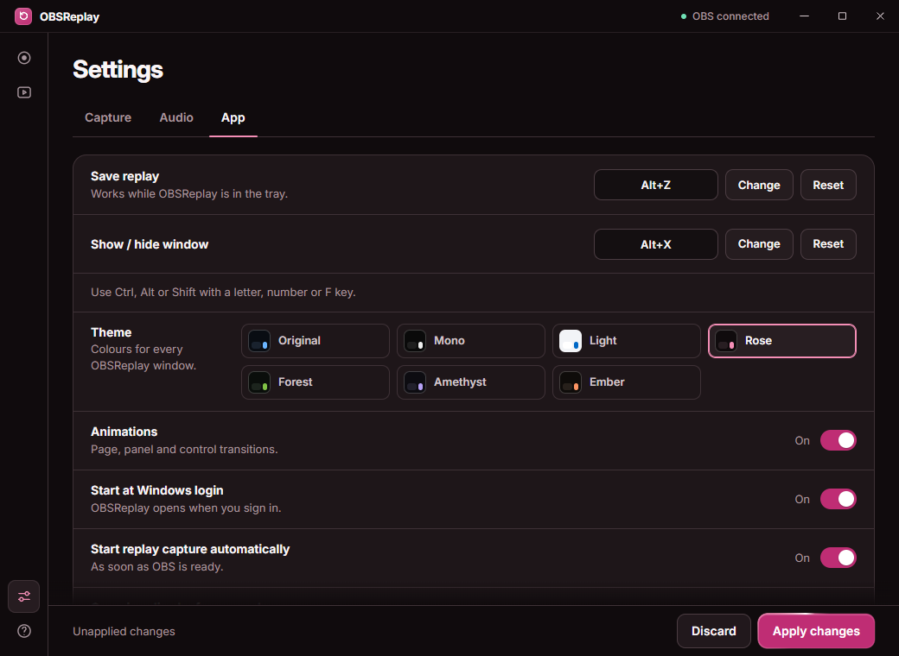

# OBSReplay

Instant replay for Windows, built on OBS Studio. Press a key and the last few minutes of your game land in a folder. Then watch, trim and export the clip without leaving the app.


> [!NOTE]
> Claude wrote the code. The UI/UX, user flow, onboarding and feature set come from me and from public recommendations. If you still hand-write code in 2026, when a model can program and diagnose in 30 seconds what would take you weeks, you are a caveman.

## Contents

- [Why OBSReplay](#why-obsreplay)
- [Features](#features)
- [Install](#install)
- [Where your files go](#where-your-files-go)
- [What it changes on your PC](#what-it-changes-on-your-pc)
- [Build from source](#build-from-source)
- [Documentation](#documentation)
- [Credits](#credits)
- [License](#license)

## Why OBSReplay

OBSReplay pairs the OBS capture engine with the convenience of ShadowPlay.

- **OBS Studio alone** has no player or library for your clips, uses encoder terms that confuse new users, and takes manual work to start capture at every Windows boot.
- **ShadowPlay alone** draws common complaints: heavy resource use, corrupted video or audio tracks, recording that turns itself off, large files, few controls and weak microphone noise suppression.
- **OBSReplay** sets up OBS for you, starts capture with Windows, and adds a clip player, a library filtered by game, trim and export, separate desktop and microphone tracks, and quality settings in plain words.

OBS does the capture and the encoding. OBSReplay installs OBS when it is missing, writes its own OBS profile, starts OBS in the tray and registers the hotkeys. Your existing OBS profiles and scenes stay as they are.

## Features

- **Guided setup.** Three steps: install what is missing, choose what to record, start. Setup checks for OBS Studio and FFmpeg and installs both with one button.
- **One-key save.** A global hotkey, `Alt+Z` by default, saves the replay buffer while you play. A sound confirms the save once OBS reports the file.
- **Three capture modes.** Game or display, fullscreen games only, or one whole display.
- **Clips library.** One folder per game, thumbnails, clip length and file size, a filter per game, 24 clips a page, separate tabs for replays and edited exports.
- **Replay viewer.** Scrub a filmstrip and waveform timeline, step by frame, zoom with the wheel.
- **Clip editor.** Split, remove and restore sections, undo and redo, per-track volume in preview, then export. Quality 10 keeps the original video and cuts on the exact frame. Lower levels re-encode to a smaller file.
- **Hardware encoding.** NVIDIA, AMD and Intel encoders with H.264, HEVC or AV1, picked from what your GPU supports.
- **Separate audio tracks.** Desktop and microphone record to their own tracks. The microphone is off until you turn it on, with optional RNNoise or Speex noise suppression.
- **Seven themes.** Original, Mono, Light, Rose, Forest, Amethyst and Ember.
- **Tray app.** Closing the window keeps the hotkeys alive. Start with Windows is optional.




## Install

Requirements:

- Windows 10 or 11, 64-bit
- [Microsoft Edge WebView2 Runtime](https://developer.microsoft.com/microsoft-edge/webview2/) (included with Windows 11)
- OBS Studio 31 or newer. Setup installs it for you.
- FFmpeg, only for exporting edited clips. Setup installs it for you.

Steps:

1. Get `OBSReplay.exe` from [Releases](https://github.com/JessePepper69/OBSReplay/releases), or [build it](#build-from-source).
2. Put it in a folder you plan to keep, then run it.
3. Follow the three setup steps. If OBS Studio or FFmpeg is missing, select **Install OBS Studio and FFmpeg**. Windows asks for permission once.
4. Select **Set up and start capture**.

There is no installer. To remove the app, see [What it changes on your PC](#what-it-changes-on-your-pc).

## Where your files go

| What | Location |
| --- | --- |
| Saved replays | `Videos\OBSReplay`, in one folder per game. Change it in **Settings**, **Capture**. |
| Edited exports | An `Edited Exports` folder next to the original clip |
| Settings, clip history, editor preferences | `%LOCALAPPDATA%\OBSReplay` |
| OBS profile and scene collection | `%APPDATA%\obs-studio`, both named `OBSReplay` |

## What it changes on your PC

- Installs or updates OBS Studio through `winget`, only when you ask it to.
- Installs FFmpeg through `winget` when you ask it to, in setup or in the editor.
- Adds an `OBSReplay` profile and scene collection to OBS. It does not edit your other profiles.
- Enables the OBS WebSocket server so the app can talk to OBS on this PC.
- Marks the OBS first-run wizard as done, so the wizard does not open over a hidden session.
- Adds an `OBSReplay` entry under `HKCU\Software\Microsoft\Windows\CurrentVersion\Run` while **Start with Windows** is on.

To undo it: open **Help**, select **Reset integration**, turn off **Start with Windows**, then delete the executable and `%LOCALAPPDATA%\OBSReplay`. Your clips stay where they are.

## Build from source

You need Windows x64, Visual Studio with the C++ desktop workload (MSVC 19.44 or newer), CMake 3.25 or newer, and Git.

```powershell
./build.ps1
```

The first build downloads the pinned dependencies. The result is `dist/OBSReplay.exe`, with the interface, icon, font, notices and runtime compiled in. There is no npm step.

To run a second copy with its own data folder, set `OBSREPLAY_DATA_DIR` to an absolute path before you start it. [docs/validation.md](docs/validation.md) covers the headless mode used for automated checks.

## Documentation

| Document | Covers |
| --- | --- |
| [docs/product.md](docs/product.md) | What the app is for and the rules it keeps |
| [docs/scope.md](docs/scope.md) | Features in and out of scope |
| [docs/architecture.md](docs/architecture.md) | Source map, native bridge, OBS integration, settings, export pipeline |
| [docs/design.md](docs/design.md) | Design system: tokens, themes, layout, components, motion |
| [docs/validation.md](docs/validation.md) | What has been tested, and how to run the checks |
| [docs/research/standalone-obs.md](docs/research/standalone-obs.md) | Research on shipping without a separate OBS install |

## Credits

- [OBS Studio](https://obsproject.com) does the capture and encoding.
- [saucer](https://github.com/saucer/saucer) hosts the WebView2 interface.
- [Inter](https://rsms.me/inter/) is the typeface, under the SIL Open Font License.
- [FFmpeg](https://ffmpeg.org) exports edited clips.

Third-party notices are compiled into the executable. Open them from **Help**, **Software notices**.

OBSReplay is not affiliated with the OBS Project.

## License

[MIT](LICENSE).
